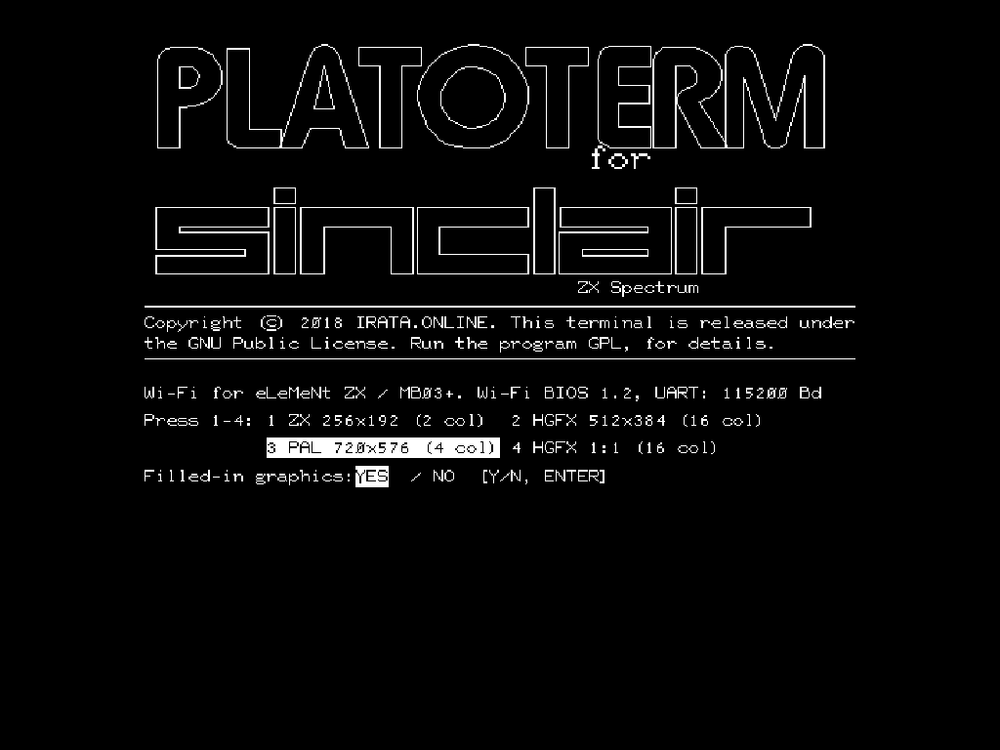
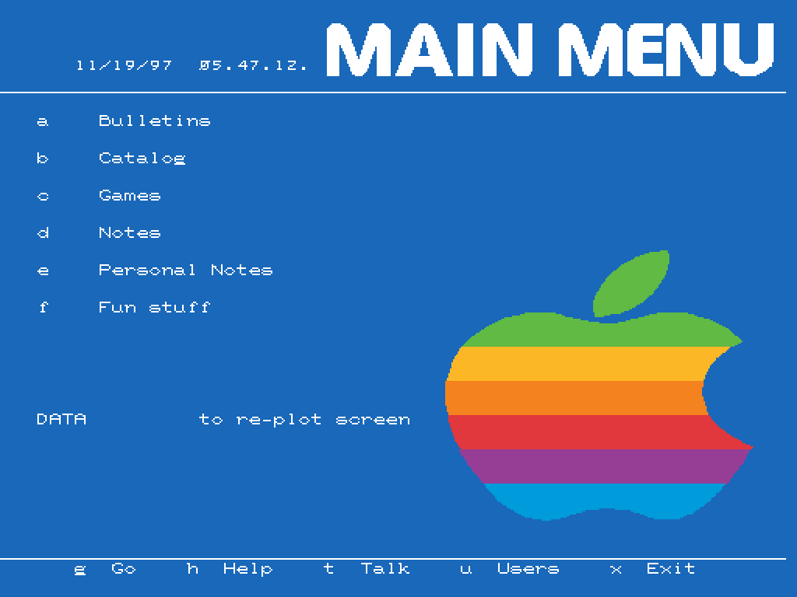
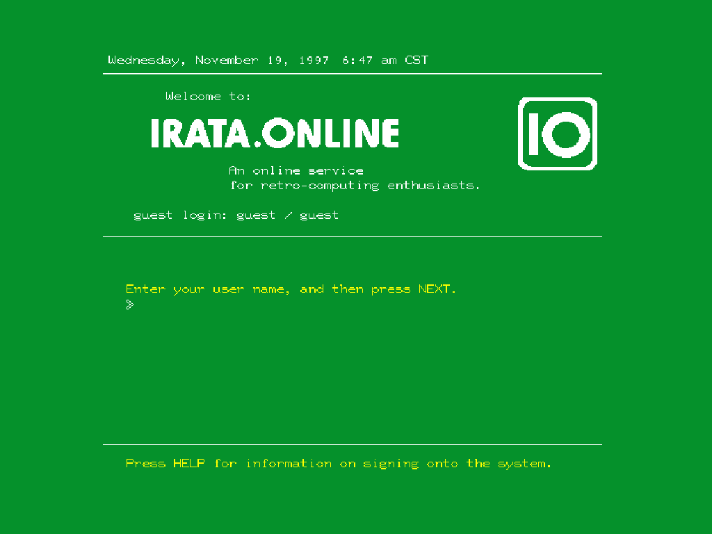
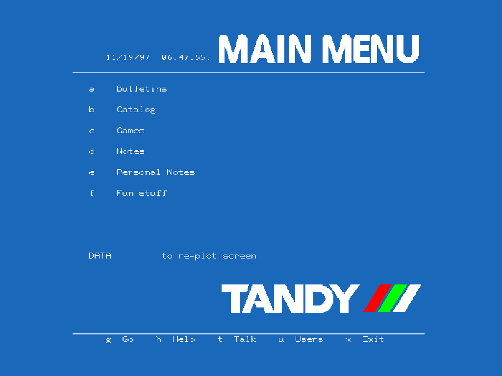
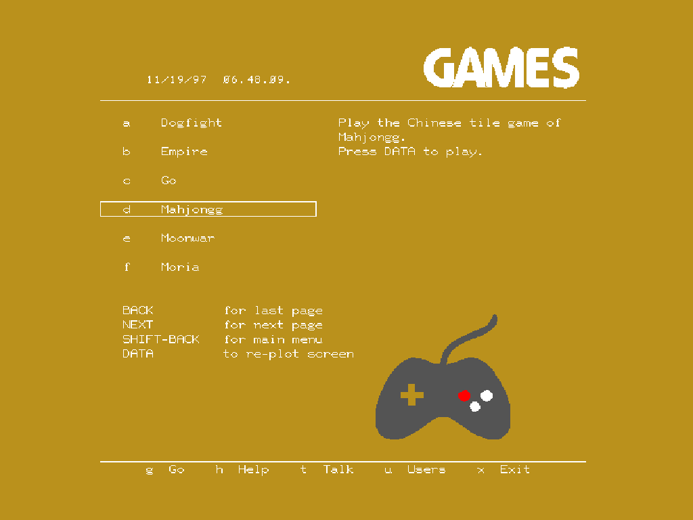
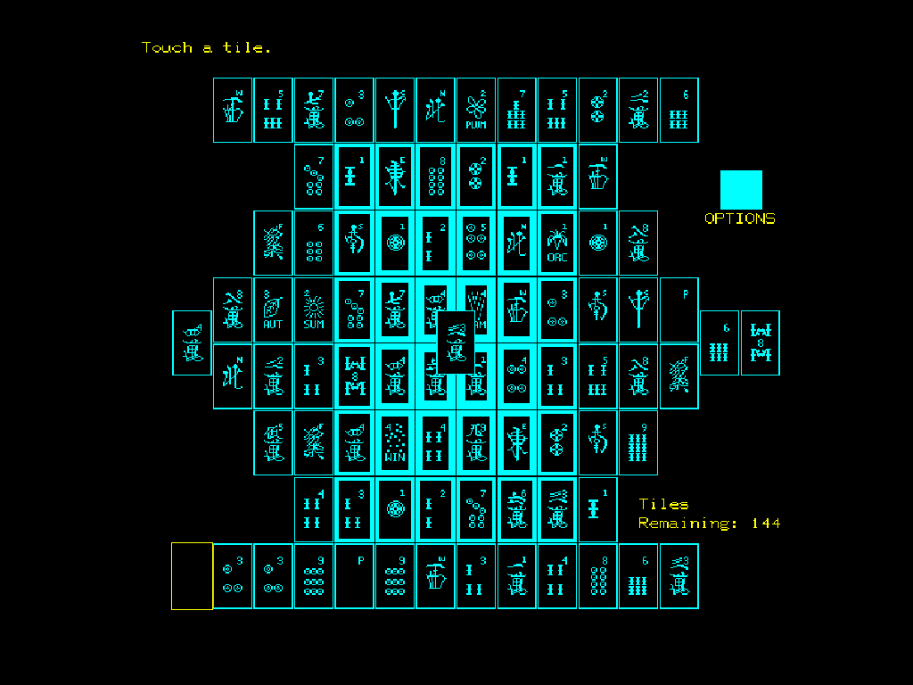

# PLATOTerm for eLeMeNt ZX / MB03+

A colour PLATO terminal for eLeMeNt ZX and MB03+ with Wi-Fi BIOS 2.1. A
single program contains the classic ZX display and three HGFX/FullPAL modes,
selectable at startup.

## Download

- **[Download PLATOTerm12_EZXMB.tap](TAP-TAR/PLATOTerm12_EZXMB.tap?raw=1)**
- **[Download the esxDOS package PTERM12.TAR](TAP-TAR/PTERM12.TAR?raw=1)**

The TAP contains the complete program and all four graphics modules. The TAR
package is intended for esxDOS and creates a `PTERM12` directory when
extracted.

## Display modes

Mode **3 – FullPAL 720×576** and **Filled-in graphics: YES** are selected by
default. Press `ENTER` to accept both defaults, or use `1`–`4` and `Y`/`N` to
change them first.

| Key | Display mode | Colours | Notes |
|---|---|---:|---|
| 1 | ZX 256×192 | 2 | classic compatible display |
| 2 | HGFX 512×384 | 16 | full page with vertical projection |
| 3 | FullPAL 720×576 | 4 | native 512×512 PLATO canvas, no scaling |
| 4 | HGFX 512×384, 1:1 | 16 | native page window; scroll with `CS+3` / `CS+4` |

The HGFX and FullPAL text, line and fill renderers are highly optimised in
assembly and use FDMA for larger transfers. PLATOTerm does not change the CPU
speed or the configured UART speed.

## Running PLATOTerm

### TAP

Load `PLATOTerm12_EZXMB.tap` and run:

```text
LOAD ""
```

### esxDOS

Extract `PTERM12.TAR` to the SD card so that it creates a `PTERM12` directory,
then run `PTERM12.BAS`. The package contains the main program, splash screen,
and the ZX, HGFX, FullPAL and HGFX 1:1 modules.

The ESP must already be connected to Wi-Fi, and the UART must use the same
speed as the ESP (normally `115200 Bd`). The terminal offers `IRATA.ONLINE`
and `cyberserv.org` on TCP port 8005. If the server disconnects an idle
session, press a key to reconnect without reloading PLATOTerm.

## Keys

- `EXTEND+0` – show PLATO key help, then restore the current screen.
- `EXTEND+X` – clean exit with BASIC and graphics registers restored.
- `CS+3` / `CS+4` – move the viewport up/down in HGFX 1:1 mode.
- `ENTER` – PLATO NEXT.
- `DELETE` – PLATO ERASE.

Whenever possible, leave the program with `EXTEND+X`. Exiting through NMI may
leave the HGFX/FDMA registers in a state that requires the computer or SD
interface to be reinitialised.

## Gallery

### Startup display selector



| HGFX 512×384 | FullPAL 720×576 |
|---|---|
|  |  |

| FullPAL main screen | FullPAL Games |
|---|---|
|  |  |

### FullPAL Mahjong



## Known limitation

Under a particular colour combination, the **GAMES** menu on IRATA.ONLINE may
overpaint part of the list or display a yellow rectangle. The official web
terminal behaves the same way, and the server author confirmed that this is a
long-standing server menu bug.

Characters appear locally after they have been returned by the server. Input
latency therefore depends on Wi-Fi, the Internet connection and the server;
PLATOTerm intentionally does not generate local echo.

## Building from source

A complete [z88dk](https://github.com/z88dk/z88dk) installation is required.

Windows PowerShell:

```powershell
powershell -ExecutionPolicy Bypass -File .\BUILD.ps1 -Z88dk D:\path\to\z88dk
```

Linux / shell:

```sh
Z88DK_HOME=/path/to/z88dk ./build.sh
```

Release files are written to `TAP-TAR/`. The optional Windows `-BuildTests`
switch also builds development and latency diagnostics; those files are not
part of the release.

Detailed development notes are available in
[POZNAMKY_PRO_PEPU.md](POZNAMKY_PRO_PEPU.md). An HGFX programming reference is
included in
[docs/element-programmers-reference.md](docs/element-programmers-reference.md).

## Credits

- Original PLATOTerm ZX: [Thomas Cherryhomes / IRATA.ONLINE](https://github.com/tschak909/platotermzx).
- Fast HGFX/FullPAL assembly renderers and major performance optimisation:
  **Pepa “SCJoe” Prokeš**. His work made text, lines and filled graphics fast
  enough for practical use, including at the original 3.5 MHz CPU speed.
- Development, eLeMeNt ZX hardware testing and release: **Milan Stava**.
- Wi-Fi BIOS 2.1 for eLeMeNt ZX / MB03+: **Busy & Hood**.
- HGFX/FDMA documentation and consultation: the eLeMeNt ZX authors and the Czech ZX community.

PLATOTerm is distributed under the GNU Public License. Original copyright and
author notices in the source code are preserved.

