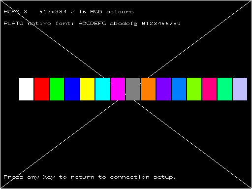
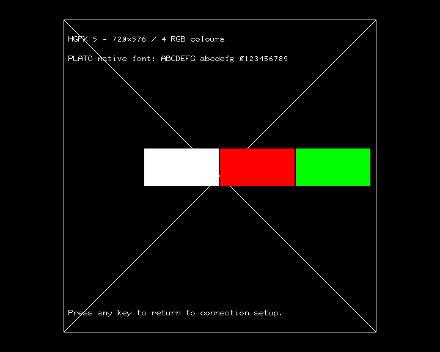

# PLATOTerm HGFX — alpha 2

Two standalone, disk-independent ESP-01 terminals for **both eLeMeNt ZX and
MB03+**, using the same supplied Wi-Fi BIOS 2.0 and passive ESP-AT backend.

| Build | Hardware mode | Colours on screen | PLATO display |
| --- | --- | --- | --- |
| HGFX 3 | g_zxi_001 = 05, 512×384 | 16, selected from 24-bit RGB | Full width; height scaled to 75%, font approximately 8×12 |
| HGFX 5 | g_zxi_001 = 07, 720×576 FullPAL | 4, selected from 24-bit RGB | Native 512×512 centered at x=104, y=32; native 8×16 font |

Both preserve PLATO's logical 512×512 coordinate space. The HGFX 3 renderer
samples glyph rows consistently in write/rewrite modes instead of combining
different source rows. The HGFX 5 renderer does not rescale coordinates.
Physical pixel aspect ratio and monitor presentation require hardware testing.

Simulated offline-test output from the executed Z80 builds (not hardware captures):





## Download

- [512×384 / 16 colours](runable/PLATOTerm_MB_EL_HGFX3_alpha2.tap?raw=true)
- [720×576 / 4 colours](runable/PLATOTerm_MB_EL_HGFX5_alpha2.tap?raw=true)
- [Original ZX display / updated shared driver](runable/PLATOTerm_MB_EL_alpha2.tap?raw=true)

These are **hardware-test builds**. Compilation, host renderer/parser tests and
executed Z80 tests with simulated HGFX/UART ports have passed. They have not yet
been tested on physical video hardware, ESP firmware or a live PLATO session.
The earlier original-display alpha 1 TAP remains available unchanged.

## First test: graphics without a network

Load the complete TAP using `LOAD ""`. The first menu uses the ordinary ZX
display. Press **T** to show an offline HGFX test: canvas border/diagonals,
RGB colour swatches and native PLATO text. Press any key to return to setup.
This test does not require an ESP, Wi-Fi or IRATA account.

If there is no useful HGFX image, reset and try the original-display TAP.
Mode 07 requires a core with FullPAL 720×576 support; old mode 06/PAL546 is not
used as an implicit fallback.

## Connect to IRATA

1. Press **Enter** at the initial menu to connect directly, or return from **T**.
2. Answer the fill question (`n` is useful for a simple first connection test).
3. Enter a hostname, or press Enter for `IRATA.ONLINE`, TCP port 8005.
4. The program preserves the UART baud and the ESP's current Wi-Fi settings.
   On an error, **R** retries; **W** accepts SSID/password without a disk file.
5. After connecting, the terminal switches to HGFX and draws the original splash.

`EXTEND 0` temporarily returns to the ZX display for the original key help,
then restores HGFX without discarding the canvas. `EXTEND 9` samples the complete
canvas into a monochrome 256×192 printer raster and invokes upstream hardcopy.
Reconnect prompts also use the ZX display. None of these operations uses a
disk OS. Keyboard/ROM interrupts must continue to run normally.

## Colour behaviour

IRATA advertises 24-bit colour on supported terminals. Each build accepts RGB
foreground/background commands and assigns exact RGB entries while slots are
available. Once all 4/16 entries are occupied, further colours use the nearest
existing entry by RGB channel distance. Entries are **not evicted while their
pixels remain visible**, avoiding recolouring older graphics. A clear resets
allocation around the requested background and foreground colours.

## Implementation and limits

- Both renderers use direct packed HGFX memory: 4 pixels/byte for HGFX 5 and
  2 pixels/byte for HGFX 3, with the leftmost pixel in the most significant bits.
- Read and write row offsets are set together. A scanline is temporarily mapped
  into Zone 0 with memory type 8; the prior layout/Ultimate mode/selected zone and
  interrupt state are restored. Code and stack remain above the ROM window.
- Register writes use a dedicated area at 0x5800, palette writes at 0x5900.
  These accesses are disabled while the original ZX console is used, and the
  register/palette state is restored afterwards. RGB input is explicitly stored
  in the configured BGR order.
- Basic M0/M1 glyphs use the original PLATOTerm JS 8×16 font; downloaded M2/M3
  glyphs retain all 8×16 source bits. Bold, rotate, reverse advance, write, erase,
  rewrite, inverse, points, lines, rectangles and optional software fill are
  implemented.
- Software flood fill uses a bounded 256-seed scanline stack. An unusually
  complex region that exhausts it stops the fill and sets a red border rather
  than overwriting memory. This remains an alpha limitation.
- The printer path is implemented but has not been tested with a physical printer.
- This work does not add new PLATO functionality absent from upstream, such as
  a mouse/touch implementation.

## Build and tests

With z88dk 2.4 and Python 3:

```sh
make -f Makefile.zx-hgfx3
make -f Makefile.zx-hgfx5
```

Each build checks RAM bounds including BSS, the supplied BIOS bytes and all TAP
block checksums. Code starts at 0x6400, stack at 0x63FF. No 128K paging or external
font/config files are needed.

The renderer's host test compiles the production C implementation with a
simulated packed framebuffer (run once per variant):

```sh
gcc -std=c99 -Wall -Wextra -Werror -Wno-int-to-pointer-cast \
    -D__HGFX__ -DHGFX_HOST_TEST -D__z88dk_fastcall= \
    -fsanitize=address,undefined -g tests/test_hgfx.c -o /tmp/test_hgfx5
ASAN_OPTIONS=detect_leaks=0 /tmp/test_hgfx5
# Add -D__HGFX3__ to compile/test the 16-colour variant.
```

Executed Z80 graphics/bus tests, using `z80==1.2.0`:

```sh
python3 tests/test_hgfx_z80.py
# Optional: --screenshots writes simulated offline-test PNGs in build-HGFX*/.
```

The linked UART tests from [the original port notes](README_MB_EL.md) also run
against either graphics build:

```sh
MBEL_BUILD=build-HGFX3 MBEL_TARGET=platoterm-hgfx3 python3 tests/test_z80.py
MBEL_BUILD=build-HGFX5 MBEL_TARGET=platoterm-hgfx5 python3 tests/test_z80.py
```

The graphics tests exercise the compiled C and assembly with simulated ports
for both device configurations, including disabled/enabled interrupt callers,
ROM-window restoration, line endpoints, RGB bytes, native glyph output, erase,
offline demo and display suspend/resume. They do not emulate analog/digital
video timing or prove FPGA behaviour/performance on real hardware.

## References and credits

- [Current eLeMeNt programmer reference](https://docs.google.com/document/d/1NJB_z3zVorTfmEj2JAS3QtAx_zbpkdCAAptHSnOOzkU/edit)
  — mode list, HGFX registers, Zone 0 chunky access and PAL viewer example.
- [Hardware author's documentation index](https://element.zxfiles.net/DOCS/INFO.HTM)
- [IRATA features](https://www.irata.online/) — 24-bit colour support.
- [PLATOTerm JS native font](https://github.com/tschak909/platotermjs/blob/dcf472fc59fd1b6935ed4b4bbe98f4365a5376fb/src/font.h)
  — retained with provenance in `vendor/plato_font8x16.h`.
- Original terminal: Thomas Cherryhomes / Steve Peltz. Shared Wi-Fi BIOS supplied
  by Hood, with its original source and credits preserved.
